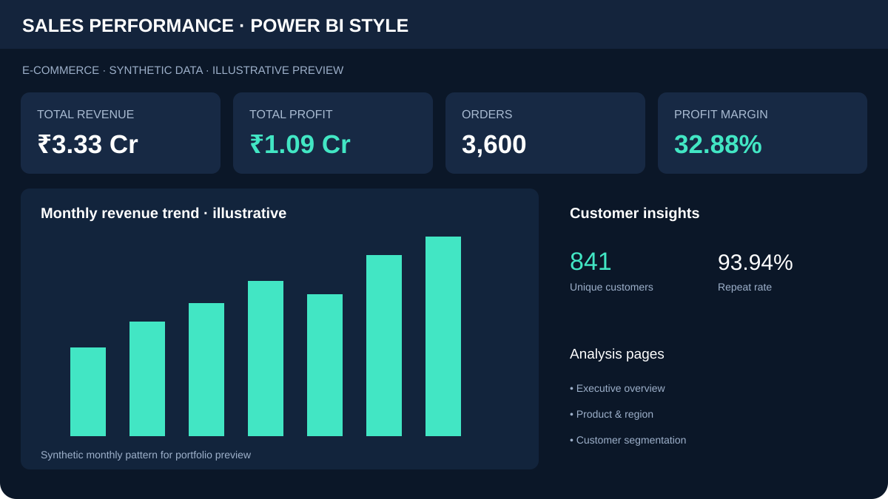

# E-commerce Sales & Customer Behaviour Analytics

End-to-end portfolio project using **SQL, Python and Power BI** to analyse online retail sales, product performance, customer purchasing patterns and RFM segments.

> **Data transparency:** The project generates a reproducible synthetic dataset for practice. It is not real company or customer data. All example results are illustrative.

## Business questions
- How do revenue, profit and orders trend month over month?
- Which categories, products, regions and channels perform best?
- Who are the highest-value and repeat customers?
- Which customers are champions, loyal, recent, at risk or need attention?
- What retention and profitability actions should the business investigate?

## Tools
Python (Pandas, NumPy), SQL (SQLite), Power BI (DAX).

## Run locally
```bash
pip install -r requirements.txt
python src/analyze.py
```
This generates the synthetic transaction data and analysis outputs under `data/` and `outputs/`.

## SQL portfolio skills
The SQL file demonstrates aggregations, joins, CTEs, window functions, ranking, repeat-purchase analysis and month-over-month growth.

## Dashboard preview



This is an illustrative Power BI-style visual built for the portfolio using the project's synthetic example metrics. It is not a screenshot from Power BI and does not replace a native `.pbix` report.

## Power BI dashboard
Import `data/ecommerce_transactions.csv`, `data/customers.csv`, `data/products.csv`, and `outputs/customer_rfm_segments.csv`. Follow `powerbi/dax_measures.md`.

Suggested report pages:
1. Executive overview: revenue, profit, orders, AOV and monthly trends.
2. Product & region: category, product and regional performance.
3. Customer insights: RFM segments, repeat customers and top customers.
4. Channel & payments: channel and payment mix.

## Resume description
**E-commerce Sales & Customer Behaviour Analytics | SQL, Python, Power BI**
- Analysed transaction-level data using SQL and Python to evaluate revenue, profitability and customer purchasing behaviour.
- Applied RFM segmentation using recency, frequency and monetary value to identify customer groups and retention opportunities.
- Prepared Power BI measures and dashboard specifications for sales KPIs, monthly trends, regional performance and customer segments.

## Limitations
The dataset and cost values are simulated. RFM labels are descriptive rules, not a predictive model. Do not present synthetic metrics as real business outcomes.
