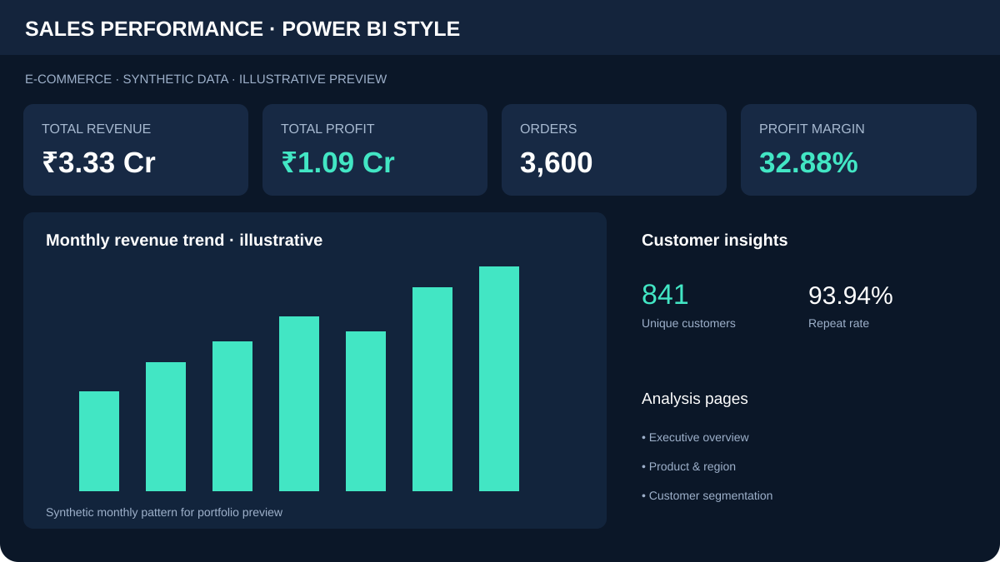
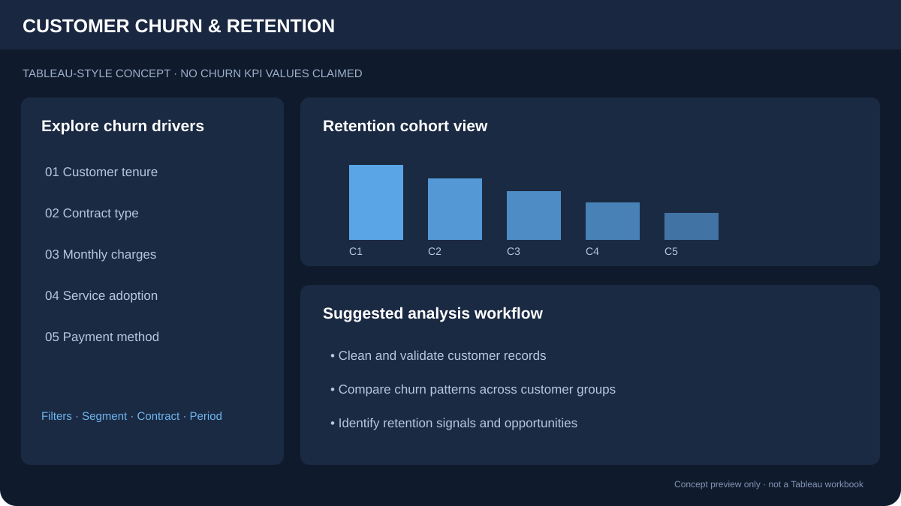
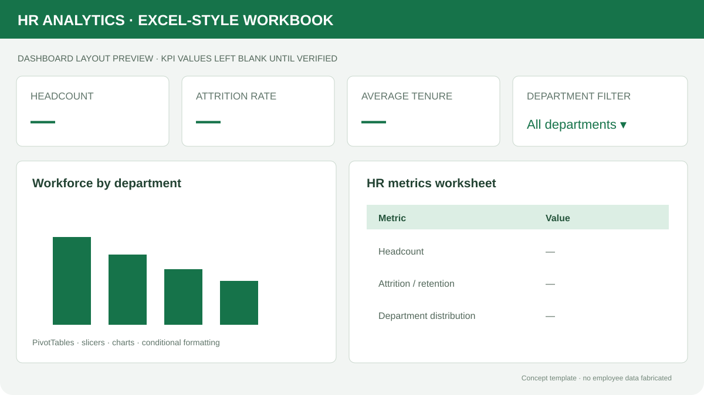

# Data Analytics Projects

A collection of independent analytics projects by **Suraj Mishra**, focused on business intelligence, data analysis, customer behaviour, and reporting.

**Portfolio:** [surajmishra217.github.io](https://surajmishra217.github.io) · **LinkedIn:** [Suraj Mishra](https://www.linkedin.com/in/suraj-mishra-25vc) · **Email:** [surajmishra16152@gmail.com](mailto:surajmishra16152@gmail.com)

---

## Featured projects

### 1. Interactive Sales Dashboard — Power BI

*Portfolio visual preview; use the linked `.pbix` file for the actual Power BI report.*
An interactive sales dashboard built to track key performance indicators and explore sales trends.

- Resume project outcome: reporting speed improved by **30%** through dynamic filters and optimized visuals.
- Resume project scope: more than **50,000 transactional rows** processed and validated.
- **Project file:** [SALES DASHBOARD.pbix](./SALES%20DASHBOARD.pbix)

### 2. Telecom Customer Churn — Python Exploratory Analysis

*Conceptual Tableau-style presentation preview. The project currently includes the Python notebook and report; this image is not a native Tableau workbook.*
An exploratory analysis of telecom customer churn, supported by a Jupyter notebook, dataset, and written report.

- The notebook's displayed dataset contains **7,043 rows and 21 columns**.
- Includes customer-level data exploration, cleaning, and visual analysis.
- **Notebook:** [TCA.ipynb](./python%20project/TCA.ipynb)
- **Dataset:** [Customer Churn.csv](./python%20project/Customer%20Churn.csv)
- **Report:** [Telco Customer Churn Analysis.pdf](./python%20project/Telco%20Customer%20Churn%20Analysis.pdf)
- **Project notes:** [Python project README](./python%20project/README.md)

### 3. HR Analytics Dashboard — Power BI

*Excel-style layout preview. KPI values are intentionally blank; this is not a screenshot of a completed Excel workbook.*
A Power BI dashboard for exploring employee and HR metrics.

- Resume project scope: analysis of **1,000+ employee records**.
- Resume project outcomes: **25%** less report-generation time and an **8%** retention improvement outcome.
- **Project file:** [HR ANALYTICS DASHBOARD.pbix](./HR%20ANALYTICS%20DASHBOARD.pbix)

### 4. E-commerce Sales & Customer Behaviour Analytics — SQL, Python & Power BI

*Illustrative preview based on the project's synthetic dataset; not a `.pbix` screenshot.*
An end-to-end analytics project using a clearly labelled synthetic retail dataset to explore sales performance, profitability, repeat purchases and customer segments.

- Generated a reproducible transaction dataset and performed analysis with Python and SQL.
- Built monthly, category and regional performance outputs and RFM customer segments.
- Includes SQL queries, Python analysis, Power BI DAX measures and dashboard build guidance.
- **Project folder:** [E-commerce Sales & Customer Behaviour Analytics](./E-commerce%20Sales%20%26%20Customer%20Behaviour%20Analytics/README.md)
- **Important:** All data and metrics are synthetic examples, not real company results.

### Additional workbook
- [Excel Project — Bike Sales workbook](./Excel%20Project/Excel%20Project%20Bike%20Sales.xlsx)
- [Workbook notes](./Excel%20Project/README.md)

---

## Tools and skills

- **SQL:** MySQL, PostgreSQL, advanced querying
- **Python:** pandas, numpy, matplotlib, seaborn, scikit-learn
- **BI and spreadsheets:** Power BI, Excel, Pivot Tables, VLOOKUP
- **Analytics:** data cleaning, data validation, exploratory analysis, funnel analysis, cohort analysis, segmentation, retention, A/B testing, statistical analysis
- **Workflow:** ETL processes, relational databases, Agile methodology, technical documentation

## About

I am pursuing an **MCA in Data Science** at Lovely Professional University (expected December 2026). I am interested in entry-level Data Analyst, Business Intelligence, and analytics opportunities.

For more information, see my [portfolio website](https://surajmishra217.github.io) or [contact me by email](mailto:surajmishra16152@gmail.com).
